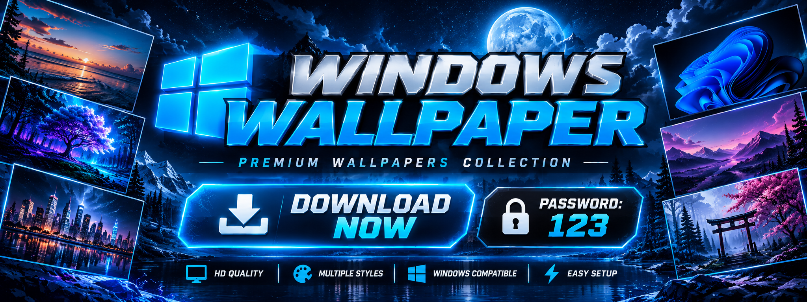

  

# 🖥️ WINDOWS WALLPAPER

### GIVE YOUR DESKTOP A NEW LOOK

**ARCHIVE PASSWORD: `123`**

 

---

## 🌌 YOUR DESKTOP. YOUR STYLE.

Discover a collection of wallpapers designed to refresh the look of your Windows desktop.

- 🖼️ Desktop background collection
- 🎨 Different visual styles
- 🖥️ Windows-focused presentation
- ⚡ Easy-to-follow download process

## 📥 GET STARTED

1. Click the download button above.
2. Download the available archive.
3. Extract the files using password `123`.
4. Choose your favorite wallpaper.

## 🖥️ PERSONALIZE YOUR DESKTOP

Right-click your desktop, open **Personalize → Background**, and select your preferred image.

## ⚠️ DISCLAIMER

This is an unofficial wallpaper collection. Windows is a trademark of Microsoft Corporation. This project is not affiliated with or endorsed by Microsoft.

### MAKE YOUR DESKTOP YOUR OWN

